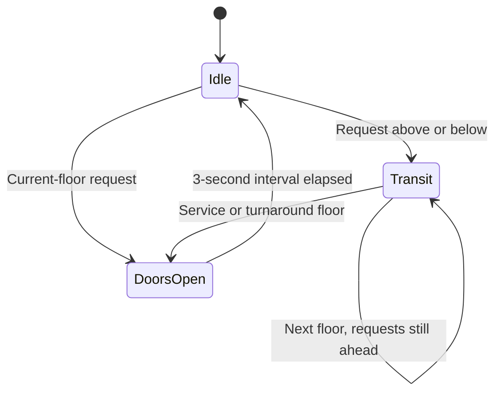

# Multi-Floor Elevator Controller

An Arduino/Proteus exercise implementing a five-floor elevator controller with queued cabin and hall requests, direction-aware service, timed travel/door states, load-dependent PWM and an OLED status display.

This repository contains a corrected sketch and the original submission separately. **Ten native controller checks pass against the actual prepared sketch using simulated hardware interfaces.** A fresh Uno build was blocked by the installed AVR compiler's Windows DLL error; Proteus behavior and physical hardware remain unverified.

## Controller behavior

- Five internal floor requests and eight up/down hall-call inputs through an MCP23017 I/O expander.
- Requests remain queued while other floors are served.
- Calls matching the travel direction are served en route; opposite-direction calls remain queued until the return trip or turnaround floor.
- Timed travel of 2 seconds per floor and a 3-second door-open state.
- Immediate clearing of served requests on arrival.
- Press-edge detection so a held button does not continually requeue its served call.
- Software floor bounds and turnaround handling prevent travel beyond floors 1–5.
- A load-input proxy maps ADC values 0–1023 to displayed values 0–350 and motor PWM 150–255; PWM is updated during transit.
- OLED reports floor, state/direction and the mapped load value.

Floor position is advanced by elapsed time. No floor-position sensor, door actuator or door-interlock input is implemented. The displayed “kg” value is a linear exercise mapping, not a calibrated weighing measurement. This is a simulation prototype, not firmware for operating a real lift.

## State flow



Motor output is stopped when opening doors. After the door interval, the controller checks remaining requests and continues or reverses direction. While idle, requests above are selected before requests below. Request polling and display updates continue through the timed states; there are no `delay()` calls in the sketch.

## Source pin map

| Function | Assignment |
| --- | --- |
| Motor enable / PWM | D10 |
| H-bridge IN1 / IN2 | D12 / D11 |
| Load-input proxy | A0 |
| OLED | I2C, address `0x3C`, 128×64 |
| MCP23017 | I2C, address `0x20` |
| Uno I2C bus | SDA A4, SCL A5 |

Inputs use active-low buttons with pull-ups. MCP port A maps cabin floors 1–5 to GPA7–GPA3 respectively. Port B maps:

| MCP pin | Hall call |
| --- | --- |
| GPB7 | Floor 1 up |
| GPB6 / GPB5 | Floor 2 down / up |
| GPB4 / GPB3 | Floor 3 down / up |
| GPB2 / GPB1 | Floor 4 down / up |
| GPB0 | Floor 5 down |

This pin map comes from the prepared sketch. Full schematic connectivity has not been verified in Proteus.

## Build for Arduino Uno

Open `firmware/ElevatorController/ElevatorController.ino` in Arduino IDE, select Arduino Uno and install the dependencies listed in `libraries.txt`. Wire is part of the Arduino core.

Arduino CLI commands from the repository root:

```text
arduino-cli core install arduino:avr
arduino-cli lib install "Adafruit GFX Library" "Adafruit SSD1306" "Adafruit MCP23017 Arduino Library" "Adafruit BusIO"
arduino-cli compile --fqbn arduino:avr:uno --output-dir build/avr firmware/ElevatorController
```

These are reproduction instructions. A successful target build has not yet been established in this preparation environment.

## Proteus circuit

Open `proteus/elevator-control.pdsprj` in a compatible Proteus installation with the original Uno, MCP23017, SSD1306 and motor-driver model support. The saved firmware property references the original local `Task3.ino.hex` build path. Repoint it to the newly compiled `ElevatorController.ino.hex` before running.

The repository also preserves a different local circuit snapshot as `archive/alternate-elevator.pdsprj`. Its revision order was not established, so it is not treated as interchangeable with the main circuit. No prebuilt firmware is included.

## Run the controller checks

Requires a C++17 compiler. From the repository root, create the ignored build folder and compile the test harness:

```text
mkdir build
g++ -std=c++17 -Wall -Wextra -Werror -I tests/fakes tests/controller_tests.cpp -o build/controller_tests.exe
```

Run `build/controller_tests.exe` on Windows. The same compile command can be adapted to the executable naming conventions of another platform. Ten checks passed with MinGW g++ 15.2.0 on Windows, including the 32-bit `millis()` rollover case. Platforms with a 64-bit `unsigned long` explicitly skip that Arduino-width check and report nine checks.

The harness includes the actual prepared `.ino` file and replaces only Arduino, I2C/display and motor interfaces with deterministic fakes. It covers all 13 button mappings, request handling during travel, direction priority, top/bottom turnarounds, served-request clearing, held buttons, load/PWM updates, floor guards and timing. A seeded 10,000-tick request sequence checks bounds and verifies the remaining queue drains after new requests stop.

Host checks verify controller logic under those fake interfaces. They do not verify AVR compilation, Adafruit library integration, electrical timing, OLED rendering or Proteus operation. See [verification details](docs/verification.md).

## Changes from the original submission

The unchanged original sketch is `archive/Task3.ino`. The prepared sketch:

- Replaces the compile-blocking `unit16_t` declaration with typed GPIO reads.
- Registers input press edges instead of repeatedly latching held buttons.
- Handles opposite-direction calls at turnaround floors.
- Clears served requests immediately on arrival, preventing repeated door cycles for the same request.
- Stops at the last request in the current direction and guards the floor range.
- Refreshes load-dependent motor PWM while travelling.

The source folder was not edited. [Source hashes and circuit inventory](docs/source-inventory.json) record the preserved originals.

## Remaining work

Complete a fresh Uno build and a Proteus run using the prepared sketch. Verify button wiring, add appropriate debounce, check display/update timing and test failure handling. The current model uses fixed travel times, a simulated door state and an uncalibrated load mapping; it has no physical position feedback, overload shutdown or emergency/interlock implementation.
